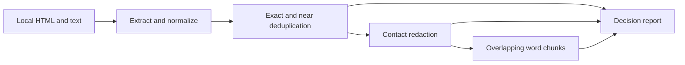

# RAG Document Cleaning

[](https://github.com/CSynStudios/rag-document-cleaning/actions/workflows/tests.yml)

A Python pipeline that prepares local HTML and text for retrieval: remove page clutter, identify duplicates, redact supported contact patterns, and export inspectable text chunks.

**Independent Project Showcase**

The implementation handles HTML and plain text, with redaction for selected contact formats. Broader PII detection and retrieval-quality evaluation are tracked as extensions.

| Verified sample | Observed result |
| --- | --- |
| Official Python documentation pages | 3 |
| Retained words | 8,957 |
| Output chunks | 61 |
| Project tests | 19 passing |

The public sample triggered no contact redactions or duplicate removals. Those behaviors are exercised by synthetic tests. These measurements apply to the documented three-page evaluation. Larger-scale capacity has not been benchmarked.

## Pipeline capabilities

- HTML extraction and Unicode/whitespace normalization with Beautiful Soup.
- Exact deduplication and MinHash LSH candidate detection with a direct Jaccard confirmation at 0.90.
- Email, Philippine mobile and `+1` US phone redaction.
- Overlapping chunks of up to 180 words, with source IDs and word offsets.
- A decision report for retained, duplicate and rejected files.
- Preserved inputs and protection against overwriting prior outputs.



## Run this repository by itself

From this repository's root, create a Conda environment once:

```powershell
conda env create --prefix ./.conda --file environment.yml
conda activate ./.conda
python -m pytest -q
```

With an existing Python 3.12 environment, install the pinned packages instead:

```powershell
python -m pip install -r requirements.txt -r requirements-dev.txt
python -m pip check
python -m pytest -q
```

The test suite uses synthetic snippets generated in temporary directories. It requires no downloaded dataset or network access. GitHub Actions runs the project tests on pushes and pull requests. The [hosted validation run](https://github.com/CSynStudios/rag-document-cleaning/actions/runs/43405189860) passed all 19 tests on Linux with Python 3.12.

## Run the documentation pipeline

```powershell
python fetch_sample.py --output data/python-docs
python clean_documents.py --input data/python-docs --output outputs/document-cleaning/run-001
```

The downloader requests three fixed Python 3.12 documentation pages and a separate license page. It records URLs, hashes and acquisition time in `data/python-docs/sources.json`. Use new input and output folder names when repeating acquisition or cleaning; existing destinations are preserved.

For approved local HTML or text, point `--input` at its directory. Input and output directories must be separate without nesting. Supported files are `.html`, `.htm` and `.txt`, in UTF-8, up to 2,000,000 bytes each and 200 documents per run.

| Output | Purpose |
| --- | --- |
| `documents.jsonl` | Retained text and supported-contact redaction counts |
| `chunks.jsonl` | Chunk text, source IDs, stable chunk IDs and word offsets |
| `report.json` | Settings, totals and per-source decisions |

Source IDs are opaque hashes of relative filenames. The sample manifest maps them to original files. They reduce accidental filename exposure and do not provide anonymization.

## Read the evidence

- [Case study](CASE_STUDY.md): problem, implementation and observed results.
- [Verification](VERIFICATION.md): test coverage, sample measurements and limitations.
- [Guidance](GUIDANCE.md): design decisions and how to inspect a run.

Python source and tests contain no comments or docstrings. Explanations are kept in Markdown.

## Limits

Names, addresses, identity numbers, secrets and unsupported contact formats remain outside the redactor's scope. Regex rules can miss or misclassify text. Near-duplicate detection can miss pairs or remove meaningful revisions, so review the decisions against the preserved originals. HTML tables and code formatting are flattened. Chunk sizes count words rather than model tokens.

Microsoft Presidio, PDF/OCR ingestion, embeddings, a vector database, retrieval evaluation and high-volume benchmarking are not implemented. No general redaction or duplicate precision/recall claim has been established.

## Sources and local data

The evaluation uses the official Python documentation for [csv](https://docs.python.org/3.12/library/csv.html), [json](https://docs.python.org/3.12/library/json.html) and [textwrap](https://docs.python.org/3.12/library/textwrap.html). Its [license page](https://docs.python.org/3.12/license.html) is preserved locally by the downloader. Source pages are cleaned, contact patterns replaced where detected, duplicates removed where identified and retained text chunked.

Downloaded documents, source manifests and generated outputs are excluded from Git. Only code, setup files, synthetic test logic and documentation belong in this repository.
