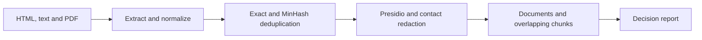

# RAG Document Cleaning

**Independent Project Showcase · v1.0.0**

[](https://github.com/CSynStudios/rag-document-cleaning/actions/workflows/tests.yml)

Prepare HTML, UTF-8 text and text-based PDFs for retrieval with boilerplate removal, exact/near deduplication, English PII redaction and traceable word chunks. Processing runs locally after setup and source acquisition.

The verified public-source run retained **4 documents** and produced **62 chunks**. The project includes 21 tests covering cleanup, redaction, duplicate decisions, chunk integrity, PDFs and failure boundaries.




## Setup

Use Python 3.12. From this repository's root:

```powershell
conda env create --prefix ./.conda --file environment.yml
conda activate ./.conda
python -m pip check
python -m pytest -q
```

An existing Python 3.12 environment can use `python -m pip install -r requirements.txt -r requirements-dev.txt` instead. In the Veyra workspace, activate the one shared environment at the workspace root; separate local environments are not required. Runtime and test dependencies are pinned separately.


## Run

```powershell
python fetch_sample.py --output data/source --include-pdf
python clean_documents.py --input data/source --output outputs/run
```

For approved local files, replace the input directory. Use a new output folder for each run. Inputs are preserved. The source downloader records URLs, acquisition time and SHA-256 values; it fetches fixed official documentation rather than crawling an entire website.

| Output | Contents |
| --- | --- |
| documents.jsonl | Retained, redacted text and source IDs |
| chunks.jsonl | Up to 180 words per chunk, 30-word overlap, source IDs and word offsets |
| report.json | Settings, redaction counts, duplicate links and rejection reasons |

## Redaction and duplicate decisions

The default mode combines contact patterns with Presidio and the pinned spaCy medium English model. Configured categories cover email, phone, multi-word English proper names, credit cards, US SSNs, IP addresses and IBANs. Person candidates must satisfy conservative capitalization and proper-noun checks to reduce removal of technical headings. `--pii-mode contacts` explicitly selects the narrower contact-only rules.

Exact copies are detected before redaction. MinHash LSH proposes near duplicates and direct five-word-shingle Jaccard similarity must reach 0.90 before removal. Decisions are recorded, and original files remain available for review.

## Operating limits

Up to 200 input documents, 2 MB per file and 200 PDF pages are supported. Encrypted, invalid and image-only PDFs are reported rather than OCR-processed. Existing output folders are never overwritten. Exit code 2 means the run completed with no retained documents.

PII detection is probabilistic and does not establish complete anonymization. Single-word names, other languages and unsupported identifiers can be missed; technical terms can still be misclassified. Near-duplicate similarity measures text overlap, not meaning. HTML layout is flattened, chunk sizes count words rather than model tokens, and retrieval relevance must be evaluated in the downstream application.

## Evidence and guidance

Read [VERIFICATION.md](VERIFICATION.md), [CASE_STUDY.md](CASE_STUDY.md) and [GUIDANCE.md](GUIDANCE.md). Source, model and output files stay local under ignored data/artifact folders. Code contains no comments; implementation guidance is in Markdown.

Sources: official Python [csv](https://docs.python.org/3.12/library/csv.html), [json](https://docs.python.org/3.12/library/json.html) and [textwrap](https://docs.python.org/3.12/library/textwrap.html) documentation with its [license](https://docs.python.org/3.12/license.html), plus the [W3C text-PDF example](https://www.w3.org/WAI/ER/tests/xhtml/testfiles/resources/pdf/dummy.pdf). Downloaded material is not redistributed in this repository.
